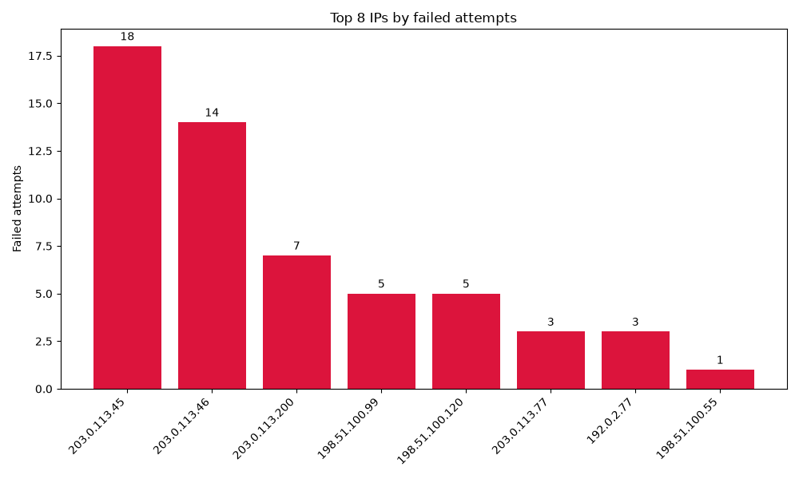

# SSH Auth Log Analyzer

A command-line tool that reads a Linux SSH `auth.log` and summarises login activity:

- Counts failed, successful and invalid-user login attempts per IP
- Lists the usernames attackers tried
- Flags **brute-force bursts** (by default, 5+ failures from one IP within 10 minutes)
- Warns about IPs that failed to log in and later succeeded
- Writes a JSON report and a bar chart of the worst offenders

Works with classic syslog timestamps (`Mar 10 13:45:01`) and ISO timestamps
(`2025-03-10T13:45:01+00:00`), IPv4 and IPv6, and lines like
`message repeated 4 times`.

## Setup

```bash
python3 -m venv .venv
source .venv/bin/activate        # Windows: .venv\Scripts\activate
pip install -r requirements.txt
```

## Usage

```bash
# Analyse the included sample log
python sshauth.py --year 2025

# Analyse your own log
sudo cp /var/log/auth.log ./auth.log
python sshauth.py --logfile auth.log
```

| Option | Default | Description |
|---|---|---|
| `--logfile` | `sample_auth_small.log` | Log file to read |
| `--report-json` | `detailed_report.json` | Where to write the JSON report |
| `--chart` | `top_attackers.png` | Where to save the chart |
| `--no-chart` | off | Skip the chart |
| `--top-n` | `10` | Number of top IPs to show and plot |
| `--year` | current year | Year of the entries (syslog lines don't include one) |
| `--window` | `10` | Brute-force time window, in minutes |
| `--threshold` | `5` | Failures within the window that count as brute force |

## Example output



## Tests

```bash
pytest
```
